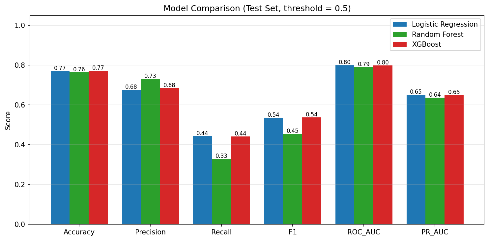
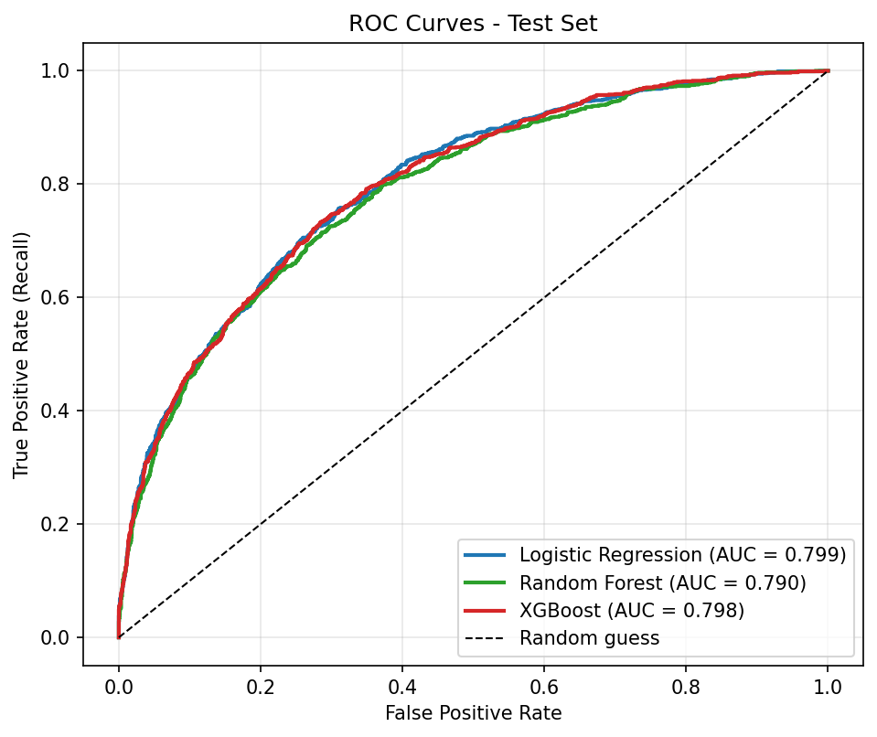
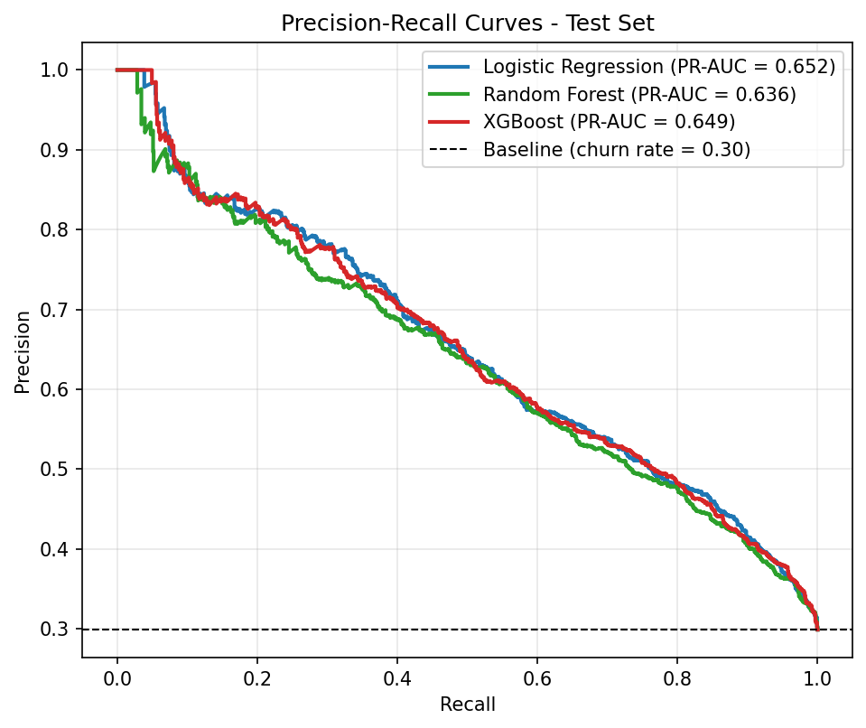
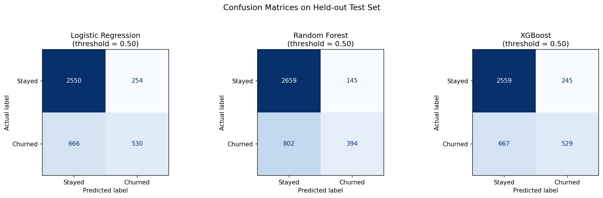
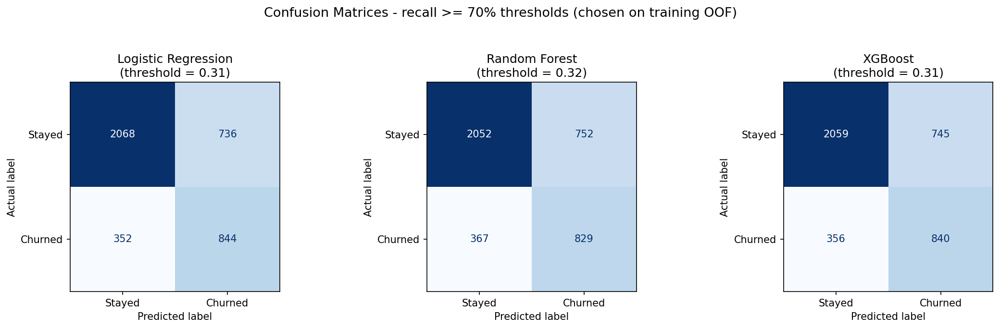
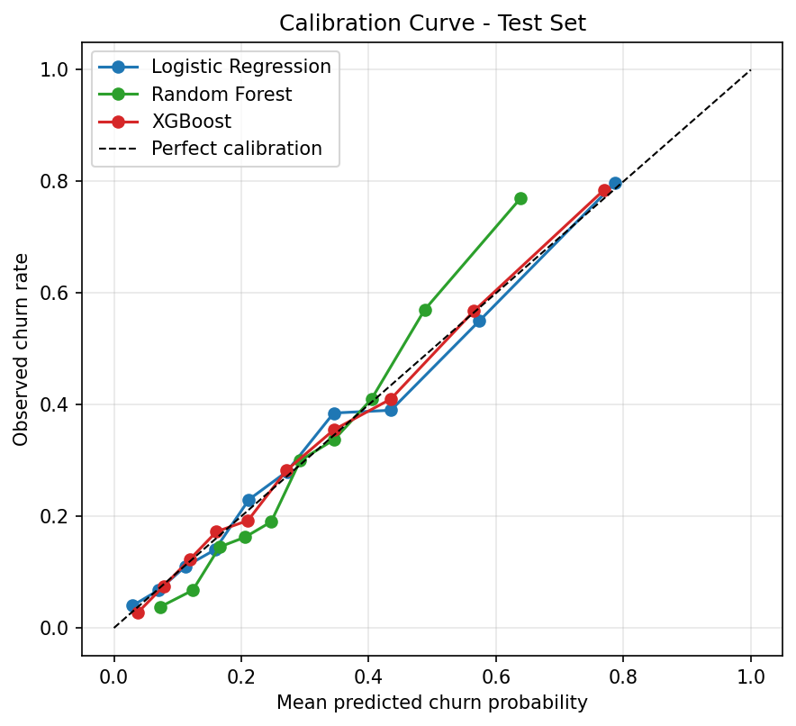
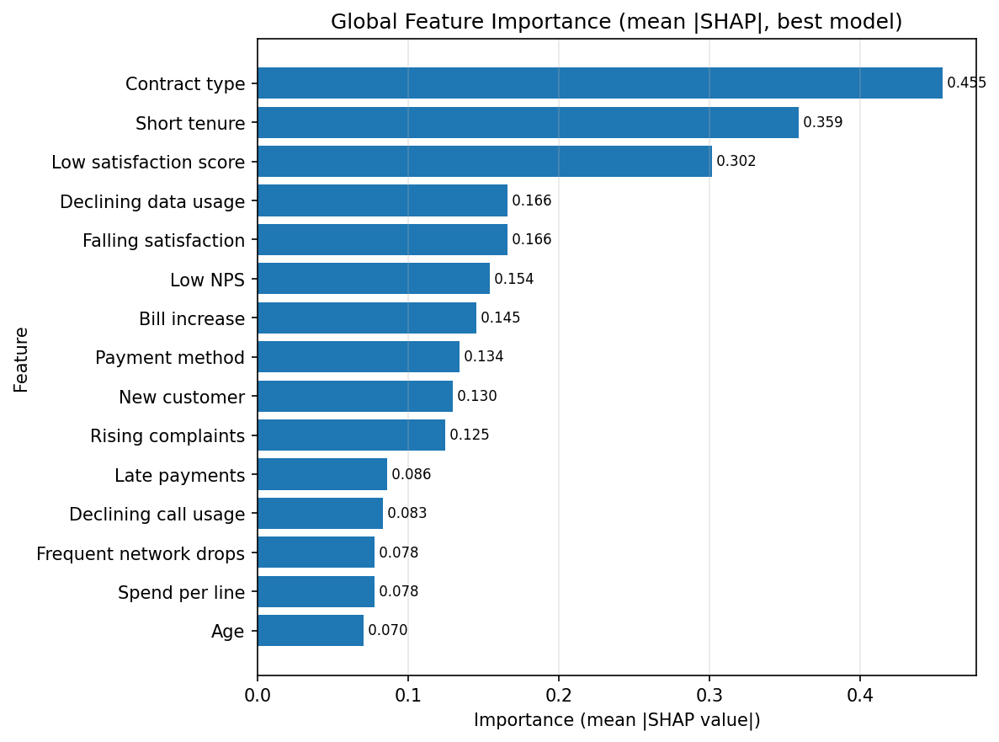
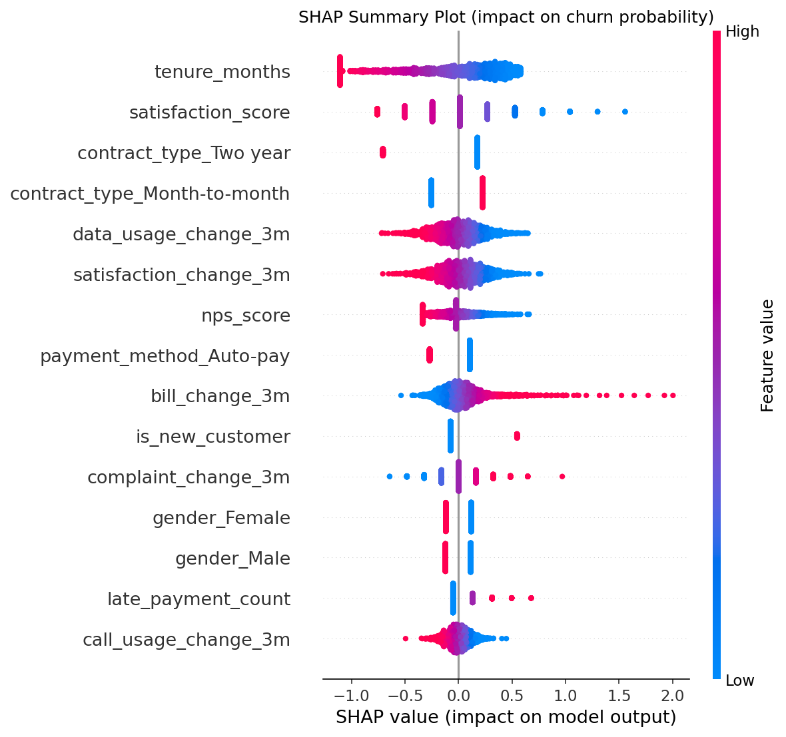
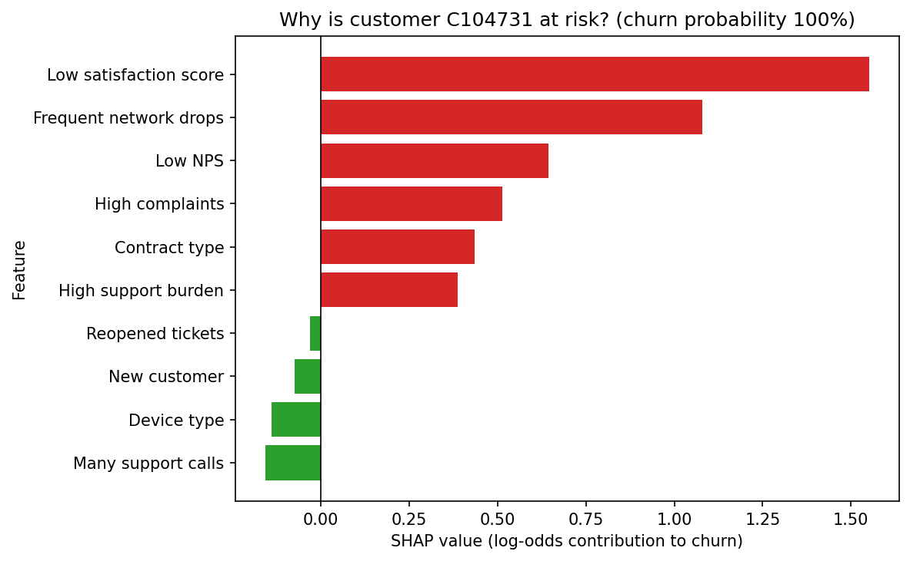

# Telecom Customer Churn Prediction & Retention Intelligence

*A classification-based machine-learning system that answers: **who** will churn, **why**, and **what to do about it**.*

---

## Abstract

Customer churn is a major revenue risk for telecom operators. This project builds an end-to-end, leakage-free machine-learning system on a synthetic telecom dataset of 20,000 customers and 37 predictive features (demographics, account, usage, billing, network quality, support and feedback, plus 3-month behavioural-change features). Three classifiers - Logistic Regression, Random Forest and XGBoost - are trained inside scikit-learn pipelines, tuned with cross-validation on the training set only, and compared with imbalance-aware metrics. The selected model (Logistic Regression) reaches a test ROC-AUC of 0.799, PR-AUC 0.652 and, at a business-chosen decision threshold, recall 0.706. Predictions are converted into churn probabilities and LOW / MEDIUM / HIGH / CRITICAL risk levels, explained with SHAP, and linked to a transparent rule-based retention layer and a customer health score. A Streamlit dashboard exposes the results. All numbers in this report are produced by the code (`src/build_report.py` reads the saved metrics).

## Introduction

Telecom is a saturated, highly competitive market: customers can switch operators easily and acquiring a new subscriber costs substantially more than retaining an existing one. Churn prediction lets an operator spend limited retention budget on the customers most likely to leave. This project goes beyond a binary "churn / no churn" label: it produces calibrated probabilities, explanations and recommended actions.

## Problem Statement

> Customer churn is a critical challenge in the telecom industry, where customers discontinue their services and move to competitors. Reducing churn can significantly improve revenue and customer loyalty. Build a classification-based machine learning model to predict whether a customer is likely to churn based on their demographic details, usage patterns, billing information, and service feedback.

## Objectives

1. Generate a realistic dataset with realistic feature relationships and a ~30% churn rate.
2. Clean the data, handle missing values properly and build leakage-free preprocessing pipelines.
3. Perform exploratory analysis and engineer behavioural-trend features.
4. Train, tune and compare Logistic Regression, Random Forest and XGBoost.
5. Output churn probability and risk level for each customer.
6. Explain predictions with SHAP and attach rule-based retention actions.
7. Provide a customer health score, a dashboard and full documentation.

## Existing Problem

Basic churn notebooks usually (a) use a static snapshot of customer attributes, (b) report accuracy only, (c) output a hard 0/1 label and (d) stop there. They ignore behavioural *change* (falling satisfaction, rising complaints, declining usage), ignore class imbalance, give no explanation of the prediction and no guidance on what to do next. Imputation is often done on the whole dataset before splitting, which leaks information.

## Proposed Solution

* **Behavioural features** that capture deterioration over the last 3 months.
* **Pipeline-based preprocessing** fitted on training data only.
* **Model comparison** with precision / recall / F1 / ROC-AUC / PR-AUC, calibration and threshold analysis.
* **SHAP explanations** aggregated to readable feature names.
* A **separate rule-based retention layer** and an interpretable **health score**, clearly distinguished from the ML prediction.

## Dataset

The dataset is **synthetic** (`src/generate_data.py`, seed 42) because no public dataset has all required feature groups. Churn is drawn from a latent logistic risk mechanism combining many features plus unobserved noise, and the intercept is calibrated so the churn rate is about 30%. The latent risk is never saved. Final dataset: **20,000 customers, churn rate 29.9%**.

| Group | Features | Notes |
|---|---|---|
| Demographics | age, gender, senior_citizen, city_tier | Possible fairness concern (see Ethics) |
| Account | tenure_months, contract_type, plan_type, number_of_lines, device_type | Longer contracts -> longer tenure |
| Usage | data_usage_gb, call_minutes, sms_count, international_minutes, roaming_usage, five_g_usage_percentage | Scaled by plan and number of lines |
| Billing | monthly_charges, total_charges, average_bill_last_3_months, late_payment_count, payment_method | Premium plans cost more; cash payers pay late more often |
| Network | network_drops, outage_minutes, average_download_speed, average_upload_speed, call_drop_rate | Driven by a hidden network-quality factor and city tier |
| Support | support_calls, complaints, average_resolution_time_hours, tickets_reopened | More frequent with poor network |
| Feedback | satisfaction_score (1-10), nps_score (-100..100), negative_feedback_count | Lower with poor network, complaints, late bills |
| Behavioural change (3 months) | data_usage_change_3m, call_usage_change_3m, bill_change_3m, complaint_change_3m, satisfaction_change_3m | Share a hidden "deterioration" factor |
| Target | `churn` (0 stayed, 1 churned) | Generated from latent risk + noise |

**Missing values** were injected intentionally: `international_minutes` 3.0%, `roaming_usage` 2.8%, `average_download_speed` 3.8%, `average_upload_speed` 4.1%, `satisfaction_score` 6.0%, `nps_score` 6.3%.

**Realism checks** (computed from the data): churn by contract type - Month-to-month: 39.0%, One year: 23.9%, Two year: 12.6%; churn by plan type - Basic: 28.3%, Premium: 31.7%, Standard: 28.9%, Unlimited: 32.1%.

## Methodology

### Preprocessing
* Numeric: `SimpleImputer(strategy="median", add_indicator=True)` (the indicator keeps the information that a value was missing), then `StandardScaler` for the linear model only.
* Categorical: most-frequent imputation, then one-hot encoding (`handle_unknown="ignore"`).
* Implemented with `ColumnTransformer` + `Pipeline`; the preprocessor is part of every model pipeline, so it is fitted **only on training data** (and only on training folds inside cross-validation).
* Missing values are *not* replaced with zero because zero satisfaction or zero speed would be impossible/misleading values.

### Exploratory Data Analysis
Twelve+ figures (`outputs/figures/eda_*.png`): churn distribution, churn by contract, plan, tenure, satisfaction, monthly charges, complaints, network drops, usage change, correlation heatmap, correlation with churn, missing values. Key patterns: churn falls strongly with contract length (Month-to-month: 39.0%, One year: 23.9%, Two year: 12.6%) and tenure; plan type has only a small effect (Basic: 28.3%, Premium: 31.7%, Standard: 28.9%, Unlimited: 32.1%); churn rises with complaints, network drops and declining usage.

### Feature Engineering
Besides the five provided change features, fixed-formula features were added (no statistics learned from the data): `spend_per_line`, `network_issue_index`, `support_intensity`, `is_new_customer`, `bill_shock`, `n_negative_trends`. Static attributes alone are not enough: a customer with satisfaction 8, one complaint and stable usage is low risk, while a customer whose satisfaction fell from 8 to 4 with rising complaints, falling usage and a higher bill is high risk even if the snapshot looks similar.

### Feature Selection
A correlation filter fitted on the training split dropped: average_bill_last_3_months (|r| > 0.95). A leakage audit (below) was run as well.

### Train / Test Split
Stratified 80/20 split with `random_state=42` (16,000 training, 4,000 test customers; churn rate preserved). In a **real production setting a temporal split is preferable**: train on earlier months and test on the most recent month, which matches how the model will be used and exposes drift; random splits can be optimistic.

### Model Selection and Tuning
* **Logistic Regression** - interpretable baseline.
* **Random Forest** - non-linear model, tuned with `RandomizedSearchCV` (n_estimators, max_depth, min_samples_leaf, max_features).
* **XGBoost** - gradient boosting, tuned with `RandomizedSearchCV` (n_estimators, max_depth, learning_rate, subsample, colsample_bytree, min_child_weight).
* Tuning: 3-fold stratified CV on the training set only, scoring ROC-AUC. Best parameters found:

- **Random Forest**: `{'n_estimators': 100, 'min_samples_leaf': 40, 'max_features': 'sqrt', 'max_depth': 14}`
- **XGBoost**: `{'subsample': 0.85, 'n_estimators': 500, 'min_child_weight': 5, 'max_depth': 4, 'learning_rate': 0.02, 'colsample_bytree': 0.6}`

* **The best model is chosen by cross-validated ROC-AUC on the training data** (out-of-fold predictions, 5 folds), never by test performance. CV ROC-AUC: Logistic Regression: 0.8001, Random Forest: 0.7880, XGBoost: 0.7966.

### Evaluation
Accuracy, precision, recall, F1, ROC-AUC, PR-AUC and Brier score on the untouched test set, plus confusion matrices, ROC and precision-recall curves and a calibration curve.

**Why accuracy alone is insufficient.** Churn is an imbalanced problem. If 90% of customers stay, a model that predicts "stay" for everybody has 90% accuracy and zero business value. Precision shows how many flagged customers really churn (wasted offers otherwise), recall shows how many churners are caught (lost revenue otherwise), F1 balances both, ROC-AUC measures ranking quality across thresholds and PR-AUC focuses on the positive class. Recall receives special attention because missing a real churner is usually costlier than a wasted retention offer.

### Data Leakage Inspection
* Forbidden names (cancellation request, termination date, retention-offer outcome, latent risk) are absent from the predictors; the audit checks for them automatically.
* All predictors represent information available **before** the churn event.
* The latent churn score is not in the dataset.
* Single-feature ROC-AUC audit on the training set: the strongest single feature is `satisfaction_score` with a separation strength of only 0.673 (0.5 = none, 1.0 = perfect); no feature reaches the 0.90 alarm level.
* Imputation, scaling, encoding, correlation filtering and threshold selection all use training data only.
* The model reaches a realistic ROC-AUC of 0.799 instead of a suspicious ~1.0.

## System Architecture


Raw data -> inspection -> missing-value handling -> encoding -> scaling -> EDA -> feature engineering -> feature selection -> stratified split -> model training (LR, RF, XGBoost) -> hyperparameter tuning -> evaluation -> best model -> churn probability -> risk classification -> SHAP explainability -> retention recommendation. (In the code, imputation/encoding/scaling are fitted *after* the split inside the pipeline to avoid leakage.)

## Results

All values below were calculated by the program on the held-out test set (4,000 customers).

### Model Comparison (decision threshold = 0.5)

| model | cv_roc_auc_train | threshold | accuracy | precision | recall | f1 | roc_auc | pr_auc | brier |
|---|---|---|---|---|---|---|---|---|---|
| Logistic Regression | 0.800 | 0.500 | 0.770 | 0.676 | 0.443 | 0.535 | 0.799 | 0.652 | 0.157 |
| Random Forest | 0.788 | 0.500 | 0.763 | 0.731 | 0.329 | 0.454 | 0.790 | 0.636 | 0.164 |
| XGBoost | 0.797 | 0.500 | 0.772 | 0.683 | 0.442 | 0.537 | 0.798 | 0.649 | 0.158 |






**Reading the table.** The three models are very close in ranking quality (ROC-AUC). This is an honest result: the synthetic data are dominated by additive effects (plus a few interactions) and contain irreducible noise, so a well-regularised linear model is competitive with boosted trees. Random Forest is the most conservative (highest precision, lowest recall at 0.5).

### Recall-oriented operating point

At 0.5 the selected model (Logistic Regression) has accuracy 0.770, precision 0.676, recall 0.443 and F1 0.535 - it misses many churners. A business that values recall can lower the threshold. Below, each threshold was chosen on **training out-of-fold predictions** as the highest cut-off that still catches at least 70% of churners (no test data used):

| model | threshold | accuracy | precision | recall | f1 | roc_auc | pr_auc | brier |
|---|---|---|---|---|---|---|---|---|
| Logistic Regression | 0.310 | 0.728 | 0.534 | 0.706 | 0.608 | 0.799 | 0.652 | 0.157 |
| Random Forest | 0.320 | 0.720 | 0.524 | 0.693 | 0.597 | 0.790 | 0.636 | 0.164 |
| XGBoost | 0.310 | 0.725 | 0.530 | 0.702 | 0.604 | 0.798 | 0.649 | 0.158 |

For Logistic Regression the chosen threshold is 0.31: recall rises to 0.706 at precision 0.534 (accuracy 0.728, F1 0.608). Accuracy falls, which is exactly the trade-off an accuracy-only analysis would hide.




### Churn probability and risk levels

Thresholds (business-oriented and adjustable in `src/retention.py`): 0-30% **LOW**, 30-60% **MEDIUM**, 60-80% **HIGH**, 80-100% **CRITICAL**. Test-set segmentation:

| risk_level | customers | mean_predicted_probability | observed_churn_rate |
|---|---|---|---|
| LOW | 2379.000 | 0.141 | 0.143 |
| MEDIUM | 1083.000 | 0.425 | 0.416 |
| HIGH | 377.000 | 0.693 | 0.714 |
| CRITICAL | 161.000 | 0.875 | 0.851 |

The observed churn rate rises across the levels and tracks the mean predicted probability closely, i.e. the probabilities are reasonably calibrated and the segments are meaningful. Output format (`outputs/predictions/churn_predictions.csv`): `customer_id, churn_probability, risk_level` (plus predicted label, health score, SHAP risk factors and recommended action). Rows with `split = train` are in-sample; use `split = test` for honest evaluation.

## Feature Importance

Mean absolute SHAP value of the selected model, aggregated back to the original feature (top 12 shown):

```
contract_type              ██████████████████████████████ 0.455
tenure_months              ███████████████████████ 0.359
satisfaction_score         ███████████████████ 0.302
data_usage_change_3m       ██████████ 0.166
satisfaction_change_3m     ██████████ 0.166
nps_score                  ██████████ 0.154
bill_change_3m             █████████ 0.145
payment_method             ████████ 0.134
is_new_customer            ████████ 0.130
complaint_change_3m        ████████ 0.125
late_payment_count         █████ 0.086
call_usage_change_3m       █████ 0.083
```

The most influential features are `contract_type` (0.455), `tenure_months` (0.359), `satisfaction_score` (0.302), `data_usage_change_3m` (0.166), `satisfaction_change_3m` (0.166), `nps_score` (0.154), `bill_change_3m` (0.145), `payment_method` (0.134). Contract type, tenure and satisfaction dominate, followed by behavioural-trend features (change in data usage, change in satisfaction), NPS and the bill change - supporting the argument that trends add information beyond static attributes.



## Explainability

SHAP values attribute each prediction to features. The summary plot shows the global direction and size of effects; the individual plot explains one customer. Explanations are computed by SHAP from the trained model, not written by hand. Example (highest-risk customer in the explained sample):

```
Customer C104731   Churn probability: 100%
Main contributing factors:
1. Low satisfaction score (value: 1.0, SHAP +1.55)
2. Frequent network drops (value: 26, SHAP +1.08)
3. Low NPS (value: -97.0, SHAP +0.64)
4. High complaints (value: 6, SHAP +0.51)
5. Contract type (value: Month-to-month, SHAP +0.43)
```




## Business Interpretation

* Rank customers by churn probability (ideally multiplied by customer value) so the retention team contacts the most valuable at-risk customers first.
* Use the SHAP factors as talking points for the agent and aggregate them to find systemic problems (for example a network problem in a region).
* Month-to-month, short-tenure customers are structurally riskier; migrating them to longer contracts is a strategic lever.
* Falling satisfaction, rising complaints and declining usage are early-warning signs that can trigger proactive outreach before the customer decides to leave.

## Retention Strategy

The retention layer (`src/retention.py`) is **rule-based and separate from the ML prediction**; the model only supplies the probability and the SHAP factors used to *rank* the rules. Examples: many network drops / high call-drop rate -> priority network support; large bill increase with high spend -> lower-cost or loyalty plan; low satisfaction with many support calls -> priority customer-service call-back; late payments -> flexible payment options; month-to-month with short tenure -> discounted 12-month contract; reopened tickets -> escalation; sharply declining usage -> re-engagement campaign.

**Customer health score** (`customer_health_score`, 0-100): a weighted business index (satisfaction 30%, network quality 20%, complaint burden 20%, payment stability 15%, engagement trend 15%) using fixed, documented normalisation bounds. It is a business analytics score, **not** the ML prediction, and it does not use the churn label.

## Ethics and Fairness

Demographic variables (gender, age, location/city tier, senior-citizen status) can create unfair treatment even when they improve accuracy, and some may be restricted by regulation. They are included here for completeness; their SHAP importance ranks are: gender #36, age #15, city tier #19, senior citizen #35 out of 42 features. Note that in the generator gender has no true effect, so any weight the model gives it is noise. In particular the small "Other" gender group (~2%) can receive a spurious coefficient - an example of why fairness testing is needed. A real operator should not assume these variables are appropriate for production and should perform **fairness testing, bias analysis, a privacy review and a regulatory review** before deployment, and should consider removing or constraining sensitive attributes and offering retention incentives consistently.

## Limitations

* **Synthetic data**: relationships are designed by us, so performance does not transfer to a real operator.
* Behavioural trends are simulated; real trend features need monthly history tables.
* No real network telemetry (cell-level congestion, coverage maps), competitor offers or customer value data.
* Random (not temporal) split; real deployments suffer concept drift and need monitoring/retraining.
* Predicting churn does not tell us whom a retention offer will actually save (see Future Scope).
* Demographic bias risk; probabilities are calibrated only on this data distribution.

## Future Scope

* **Uplift / treatment-effect modelling.** Ordinary churn prediction answers *"Who is likely to churn?"*. An advanced system should answer *"Who is likely to churn AND who can actually be saved by an intervention?"* Example: Customer A has 90% churn probability but a retention offer is unlikely to help (they are leaving regardless); Customer B has 70% churn probability and an offer would very likely prevent churn. Customer B may be the better target. This needs data from randomised retention experiments and methods such as two-model (T-learner), class-transformation or causal-forest uplift models; it is presented as future work because it cannot be done correctly with purely observational, synthetic data.
* Real-time churn scoring and streaming features; temporal/sequence models on monthly histories.
* Customer lifetime value to prioritise by expected revenue saved.
* Causal inference and A/B testing of interventions; personalised retention offers; automated CRM integration.
* Validation on real telecom data; fairness audits; drift monitoring.

## Conclusion

The project delivers a complete, reproducible and explainable churn system. The chosen model (Logistic Regression) achieves ROC-AUC 0.799 on unseen customers with well-calibrated probabilities; lowering the decision threshold to 0.31 catches 0.706 of churners at a precision of 0.534. SHAP shows that contract, tenure, satisfaction and behavioural trends drive the risk, and the retention layer turns each prediction into a concrete next step. Results on synthetic data are indicative only, but the workflow - leakage-free preprocessing, imbalance-aware evaluation, explainability, and a clear separation between prediction and business rules - is what would be reused on real data.
