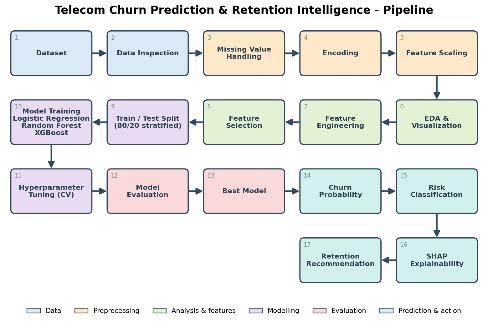

# Telecom Churn AI - Prediction & Retention Intelligence

An end-to-end machine-learning project that predicts **who** will churn, explains **why** (SHAP) and suggests **what to do** (rule-based retention layer), with a Streamlit dashboard.

## Features
* Synthetic, realistic dataset: 20,000 customers, 37 predictors, churn rate 29.9%, intentional missing values
* Leakage-free scikit-learn pipelines (`ColumnTransformer` + `Pipeline`), median imputation with missing-indicators
* Behavioural-trend features (3-month changes in usage, bill, complaints, satisfaction)
* Logistic Regression, Random Forest, XGBoost with `RandomizedSearchCV`
* Imbalance-aware evaluation, calibration, recall-oriented threshold
* Churn probability + LOW/MEDIUM/HIGH/CRITICAL risk levels
* SHAP global and per-customer explanations
* Rule-based retention actions and a `customer_health_score` (business score, not ML)
* Streamlit dashboard, Jupyter notebook, full report

## Dataset
Synthetic (seed 42), generated by `src/generate_data.py` -> `data/telecom_churn.csv`. Groups: demographics, account, usage, billing, network quality, support, feedback and 3-month behavioural change. Churn is generated from a hidden latent risk plus noise (not exposed as a feature).

## ML Models
Logistic Regression (baseline), Random Forest, XGBoost. Best model by cross-validated ROC-AUC: **Logistic Regression**.

## Architecture


```
telecom-churn-ai/
├── data/telecom_churn.csv
├── notebooks/telecom_churn_analysis.ipynb   (built by notebooks/build_notebook.py)
├── src/  generate_data.py  preprocessing.py  eda.py  train_models.py  evaluate.py
│         explain.py  predict.py  retention.py  flow_diagram.py  build_report.py
├── models/  logistic_regression.pkl  random_forest.pkl  xgboost.pkl  best_model.pkl  model_config.json
├── outputs/ figures/  predictions/  metrics/
├── app/app.py
├── requirements.txt  README.md  PROJECT_REPORT.md
```

## Installation
```bash
cd telecom-churn-ai
python3 -m venv .venv && source .venv/bin/activate      # macOS / Linux
pip install -r requirements.txt
```

## Usage
Run from the project root, in this order:
```bash
python src/generate_data.py      # create data/telecom_churn.csv
python src/eda.py                # EDA figures
python src/flow_diagram.py       # flow diagram image
python src/train_models.py       # preprocessing, tuning, evaluation, models, SHAP (takes a few minutes)
python src/predict.py            # churn_predictions.csv (probability, risk level, factors, action)
python src/build_report.py       # regenerate README/PROJECT_REPORT from the saved metrics
streamlit run app/app.py         # dashboard
```
Score a single customer explanation: `python src/predict.py --customer C100123`; score a new CSV: `python src/predict.py --input new_customers.csv`.

### Running the notebook
```bash
python notebooks/build_notebook.py      # (re)creates the .ipynb
jupyter notebook notebooks/telecom_churn_analysis.ipynb
# or execute headless:
jupyter nbconvert --to notebook --execute --inplace notebooks/telecom_churn_analysis.ipynb
```
(Run `train_models.py` and `predict.py` first; the notebook reuses their saved outputs.)

## Results (test set, 4,000 customers, threshold 0.5)

| model | cv_roc_auc_train | threshold | accuracy | precision | recall | f1 | roc_auc | pr_auc | brier |
|---|---|---|---|---|---|---|---|---|---|
| Logistic Regression | 0.800 | 0.500 | 0.770 | 0.676 | 0.443 | 0.535 | 0.799 | 0.652 | 0.157 |
| Random Forest | 0.788 | 0.500 | 0.763 | 0.731 | 0.329 | 0.454 | 0.790 | 0.636 | 0.164 |
| XGBoost | 0.797 | 0.500 | 0.772 | 0.683 | 0.442 | 0.537 | 0.798 | 0.649 | 0.158 |

At the recall-oriented thresholds (chosen on training out-of-fold predictions):

| model | threshold | accuracy | precision | recall | f1 | roc_auc | pr_auc | brier |
|---|---|---|---|---|---|---|---|---|
| Logistic Regression | 0.310 | 0.728 | 0.534 | 0.706 | 0.608 | 0.799 | 0.652 | 0.157 |
| Random Forest | 0.320 | 0.720 | 0.524 | 0.693 | 0.597 | 0.790 | 0.636 | 0.164 |
| XGBoost | 0.310 | 0.725 | 0.530 | 0.702 | 0.604 | 0.798 | 0.649 | 0.158 |

Risk segmentation (test set):

| risk_level | customers | mean_predicted_probability | observed_churn_rate |
|---|---|---|---|
| LOW | 2379.000 | 0.141 | 0.143 |
| MEDIUM | 1083.000 | 0.425 | 0.416 |
| HIGH | 377.000 | 0.693 | 0.714 |
| CRITICAL | 161.000 | 0.875 | 0.851 |

Top features (mean |SHAP|): `contract_type` (0.455), `tenure_months` (0.359), `satisfaction_score` (0.302), `data_usage_change_3m` (0.166), `satisfaction_change_3m` (0.166), `nps_score` (0.154), `bill_change_3m` (0.145), `payment_method` (0.134).

## Notes
* Thresholds for risk levels are business-oriented and adjustable in `src/retention.py`.
* Retention actions and the health score are rule-based business logic, not ML output.
* Rows with `split = train` in the predictions file are in-sample; evaluate on `split = test`.
* Data are synthetic: do not interpret the numbers as real-world telecom performance.

## Future scope
Uplift modelling ("who can be saved?"), temporal models on monthly histories, real-time scoring, customer lifetime value, causal inference, personalised offers, CRM integration, real telecom data, fairness testing and drift monitoring.
